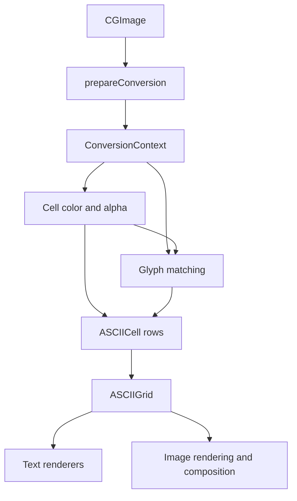

# Architecture

This page describes the implementation in the current checkout. Start with the
[agent navigation guide](agents/navigation.md) to locate a change, the
[generated symbol map](repo-map.generated.md) to find a declaration, or
[DESIGN.md](../DESIGN.md) for the matcher's mathematical lineage and limitations.
Setup and checks live in [CONTRIBUTING.md](../CONTRIBUTING.md) and the
[validation guide](agents/validation.md).

## Products, targets, and layout

[Package.swift](../Package.swift) defines the target graph, dependency bounds,
Swift language mode, resources, and platform minimums. The package uses Swift
6.3 or later in Swift 6 language mode and targets iOS 18, macOS 15, and visionOS 2
or later. The executable workflow requires macOS and Xcode.

| Boundary | Owner | Responsibility |
| --- | --- | --- |
| Library | [Sources/Aski](../Sources/Aski/) | Conversion, grids, rendering, masks, animation, video, and effects; no third-party runtime dependency |
| Product command | [AskiCLI](../Tools/AskiCLI/), [AskiCLIRunner](../Tools/AskiCLIRunner/) | Command composition and the async process entry point for `aski` |
| CLI support | [AskiToolSupport](../Tools/AskiToolSupport/) | File loading, argument validation, output transactions, metadata, manifests, and shared lab helpers |
| Research labs | [Tools](../Tools/) | Six importable lab modules, exposed through `aski lab`; historical `Aski*Lab` executables delegate to those modules |
| Generated artifacts | [BuildStandardVectors](../Tools/BuildStandardVectors/), [BuildKernelLibrary](../Tools/BuildKernelLibrary/), [BuildResearchIndex](../Tools/BuildResearchIndex/), [BuildRepoMap](../Tools/BuildRepoMap/) | Glyph assets, Metal library, research registry, and declaration map |
| Tests and measurement | [Tests/AskiTests](../Tests/AskiTests/), [Benchmarks/AskiBenchmarks](../Benchmarks/AskiBenchmarks/) | Swift Testing, snapshots, parity contracts, and `package-benchmark` workloads |

Auxiliary targets live under `Tools/`, `Tests/`, and `Benchmarks/`, not under
`Sources/`. `AskiDemo` and `AskiTileMatrix` are executable targets for repository
use; the explicitly published products are the library, `aski`, and six lab
replay executables. The [tool inventory](agents/tooling.md) covers commands and
regeneration ownership without duplicating the manifest here.

The library imports Apple system frameworks, including CoreGraphics, CoreText,
CoreImage, Accelerate, and AVFoundation. The package's third-party dependencies
serve tools (`swift-argument-parser`), tests (`swift-property-based`,
`swift-snapshot-testing`, `swift-numerics`), or benchmarks (`package-benchmark`).
No tool or lab module is a dependency of `Aski`.

## Pipeline (CGImage → ASCIIGrid)

The main entry is [ASCIIConverter](../Sources/Aski/ASCIIConverter.swift), generic
over `ASCIICharacterSet` and `ASCIIPalette`. `DefaultConverter()` selects
`.standard` glyphs and `.fullColor`. Its defaults are `.logPolar`, `.wide`,
`oversample: 2`, sRGB, linear-light color averaging, OKLab Euclidean palette
matching, Ray Trace gamut mapping, and encoded-display 8-bit composition.
[RenderingOptions](../Sources/Aski/RenderingOptions.swift) defaults its five
ordinary knobs to zero. Library defaults, CLI choices, and the frozen research
reference are separate recipes; read the owner before changing one.

Color and matching share one context. The diagram separates responsibilities;
[ConversionEngine.renderRows](../Sources/Aski/ConversionEngine.swift) executes
color finalization and glyph capture in the same cell loop. It returns nested
`[[ASCIICell]]` rows. Ordinary, ranked, and residual conversion select concrete
capture types once by algorithm; temporal conversion has its own path. These are the concrete data owners to
follow when tracing conversion.

### Preparation and input ownership

`prepareConversion` snapshots the rendering options and palette, resolves grid
geometry, samples optional mask coverage, and prepares a raster exactly tiled
by whole cells. [CellSampling.swift](../Sources/Aski/CellSampling.swift) owns
`gridDimensions`, `samplingMaxPixelSize`, `samplingLattice`, and
`ConversionContext`; [TileGridConverter](../Sources/Aski/Tiles/TileGridConverter.swift)
uses the same geometry rules.

The budget protects portrait width and `.tall` landscape height without
upscaling small sources. A floored integer cell pitch defines the lattice:
`columns * cellWidth` by `rows * cellHeight`. A large decoded source is converted
to premultiplied RGBA8 in the target gamut and resampled directly to that lattice
with vImage Lanczos, then clipped to alpha to bound overshoot. An input already
within the budget is drawn with CoreGraphics `.high` interpolation. No
bottom/right remainder is discarded and no PNG encode/decode round trip occurs.
See the [oversampling contract](../Sources/Aski/Aski.docc/Algorithms.md#oversampling)
and [direct-preparation decision](Research/2026-11-10-aski-1-direct-cgimage-preparation.md).

File-based image tools use
[DemoImageIO.loadThumbnailForConversion](../Tools/AskiToolSupport/ImageFileIO.swift)
to ask ImageIO for a conversion-sized thumbnail before materializing a full
raster. The loader derives its budget from the destination converter's
`preparationMaxPixelSize`, applies EXIF orientation, and retries when ImageIO's
rounding undershoots the required portrait width. `render` and `inspect` share
[ToolImageConversion](../Tools/AskiToolSupport/ToolImageConversion.swift), so
reported dimensions and counts describe the grid actually produced.

Preparation contracts are pinned by
[SamplingLatticeContractTests](../Tests/AskiTests/SamplingLatticeContractTests.swift),
[SamplingMaxPixelSizeTests](../Tests/AskiTests/SamplingMaxPixelSizeTests.swift),
[TargetSizePreparationTests](../Tests/AskiTests/TargetSizePreparationTests.swift),
and [ConversionThumbnailLoaderTests](../Tests/AskiTests/ConversionThumbnailLoaderTests.swift).

### Glyph matching and shared state

[GlyphBank](../Sources/Aski/CharacterSets/GlyphBank.swift) is the immutable owner
of glyphs, normalized brightness, raw density, and packed 60D descriptors.
Library-owned character sets and their converters share that bank. External
`ASCIICharacterSet` conformers are snapshotted when the converter initializes or
its `characterSet` is assigned; changing an external reference later requires
reassignment. Empty sets and mismatched parallel-array lengths trap at that
boundary. Use [RasterizedCharacterSet](../Sources/Aski/CharacterSets/RasterizedCharacterSet.swift)
for font-and-glyph input, and read the
[extension contract](../Sources/Aski/ASCIICharacterSet.swift) before implementing
raw matching arrays.

[LogPolarKernel](../Sources/Aski/Algorithms/LogPolarKernel.swift) constructs the
query, then [ShapeMatching](../Sources/Aski/ShapeMatching.swift) ranks a brightness
shortlist by squared L2 distance. Each `ConversionContext` now owns one immutable
[ShapeContext.Footprint](../Sources/Aski/Algorithms/ShapeContext.swift): its
pixel-to-bin map is shared across cells and row workers, while each histogram
keeps independent accumulation storage and raster-order additions. This is the
adopted ASKI-87 optimization; earlier rejected bin-table experiments are
historical, not the current implementation. [Native replay evidence](benchmark-validation.md#native-replay-result--2026-11-12)
and [footprint parity tests](../Tests/AskiTests/ShapeContextFootprintTests.swift)
record its scope. The later scoped-histogram-storage candidate was
[rejected](Research/2026-11-15-aski89-histogram-storage.md); production still owns
its histogram and packed lane arrays.

A one-pixel cell axis cannot carry a shape descriptor. That geometric condition
selects tone-only ranking rather than allowing the zero query to favor the space
glyph. This is distinct from a supported footprint whose content happens to
produce a zero histogram. `dotMatrix` uses density and optional Floyd–Steinberg
diffusion instead. The [algorithm guide](../Sources/Aski/Aski.docc/Algorithms.md)
and [design notes](../DESIGN.md) explain these behaviors and the remaining
small-footprint limits.

[GridRowWalk](../Sources/Aski/GridRowWalk.swift) runs log-polar rows in parallel
when there is more than one row and at least 1,200 cells, and joins before returning. Workers write disjoint rows
and candidate/residual ranges; smaller grids stay serial. Dot-matrix always
stays serial because diffusion depends on cell order. Preserve the
[serial/parallel parity contract](../Tests/AskiTests/ParallelWalkParityTests.swift)
when changing storage or scheduling.

### Color, rendering, and masks

`ConversionContext` samples source color, computes adjusted OKLab lightness,
resolves the palette, and maps display color to the target gamut. The glyph
shortlist uses that adjusted lightness, while its shape descriptor uses a
separate encoded-luma signal. [ColorConversion](../Sources/Aski/ColorConversion.swift),
[ResolvedPalette](../Sources/Aski/ResolvedPalette.swift), and
[GamutMapping](../Sources/Aski/GamutMapping.swift) own those operations.
[ColorPipelinePolicies](../Sources/Aski/ColorPipelinePolicies.swift) defines
ordinary defaults and experimental alternatives; an available policy is not
necessarily a demonstrated output-quality improvement.

[ASCIIGrid](../Sources/Aski/ASCIIGrid.swift) carries cells, render color space,
composition policy, and mask rendering state. Converter output is rectangular,
but manually constructed grids may be ragged. Images allocate the widest-row
canvas; text preserves supplied row lengths. Missing positions retain the
canvas during mask composition rather than receiving fallback or ground paint.
[Renderers](../Sources/Aski/Renderers/) produce plain text, attributed text, and
CoreGraphics images. [Effects](../Sources/Aski/Effects/) builds the Core Image
composition and effect graph.

The exact-width image overload renders at four times the requested width, then
area-averages in linear light. `ASCIIGrid.maxTargetPixelWidth` accounts for the
supersampled bitmap ceiling; excessive width or derived height returns the
library's 1×1 fallback. The CLI rejects such a result instead of writing it.
The direct target-width arm remains research SPI. See the
[rendering guide](../Sources/Aski/Aski.docc/Rendering.md),
[target-width decision](Research/2026-09-01-aski63-target-width-verdict.md), and
[target-width tests](../Tests/AskiTests/ImageRendererTargetWidthTests.swift).

Mask coverage is sampled before conversion and attached to each cell; matching
still runs for every cell. [Masking](../Sources/Aski/Masking/) owns coverage,
fallback, and ground composition. Paint colors are interpreted in their
`CGColor`'s declared space. The ASCII composition policy selects the
CoreGraphics raster space; later Core Image operations and a deferred
`renderCIImage` consumer retain their own working-space choices. Tiles have no
ASCII composition-policy knob. Use the [mask route table](../Sources/Aski/Aski.docc/Masking.md)
and [composition-space decision](Research/2026-11-15-aski103-composition-spaces.md)
when changing a stage; a single global claim about encoded versus linear
composition is insufficient.

### Animation and video

[ASCIIConverter+Animation](../Sources/Aski/ASCIIConverter+Animation.swift) ranks
candidates in one conversion pass. [AnimatedASCIIGrid](../Sources/Aski/Animation/AnimatedASCIIGrid.swift)
selects among those candidates on a deterministic schedule; it does not rerun
conversion for each animation frame. [AnimatedASCIIGrid](../Sources/Aski/Animation/AnimatedASCIIGrid.swift) and
[ASCIIGrid.applyingOngoingPattern](../Sources/Aski/Animation/ASCIIGrid+OngoingPattern.swift)
reuse the pulse multiplier once per frame, using
[PatternEvaluator](../Sources/Aski/Animation/PatternEvaluator.swift). The temporal research path in
[ASCIIConverter+Temporal](../Sources/Aski/Animation/ASCIIConverter+Temporal.swift)
is distinct from ordinary scheduled animation and is exposed through research SPI.

[ASCIIVideoDecoder](../Sources/Aski/Video/ASCIIVideoDecoder.swift) preserves the
public `grids` callback's one-pull/one-decode behavior. `pipelinedGrids` allows one
ordered prefetch, overlapping decode/conversion of the next frame with
render/encode of the current frame. It does not fan out conversion across frames.
[convertVideo](../Sources/Aski/Video/ASCIIVideoConverter.swift) chooses between:

- No `targetFPS`: the bounded `pipelinedGrids` path.
- With `targetFPS`: internal `selectedGrids`, using
  [VideoFrameSelectionPump](../Sources/Aski/Video/VideoFrameSelectionPump.swift)
  to select decoded source identities before conversion and reuse a converted
  grid for duplicate output slots. Codec decode still occurs; the optimization
  avoids unnecessary ASCII conversions. Prefetch follows selection.

The [early-selection evidence](../Scripts/research/video-frame-selection.md)
and [integration tests](../Tests/AskiTests/VideoEarlySelectionIntegrationTests.swift)
cover output pixels, timestamps, and reports.
[VideoSelectionLifetimeTests](../Tests/AskiTests/VideoSelectionLifetimeTests.swift)
and [VideoPipelineTests](../Tests/AskiTests/VideoPipelineTests.swift) cover
lifetime, cancellation, ordering, and bounded overlap. GIF conversion has its
own [decoder](../Sources/Aski/Video/ASCIIGIFDecoder.swift),
[converter](../Sources/Aski/Video/ASCIIGIFConverter.swift), and
[encoder](../Sources/Aski/Video/ASCIIGIFEncoder.swift); do not infer GIF buffering
or selection behavior from the MP4 path.

## Command-line product

`aski` is a thin reference client over the library. It owns files and records,
not a second conversion engine. [AskiCommand](../Tools/AskiCLI/AskiCommand.swift)
composes `render` (also the default), `inspect`, `metadata`, and `lab`.
[AskiCLIRunner](../Tools/AskiCLIRunner/main.swift) owns the async process entry;
[AskiToolSupport](../Tools/AskiToolSupport/) owns shared work. User recipes and
flags belong in the [command-line guide](../Sources/Aski/Aski.docc/CommandLine.md).

| Record | Producer / schema | Contract |
| --- | --- | --- |
| Inspection | [AskiInspectCommand](../Tools/AskiToolSupport/AskiInspectCommand.swift), [inspect v1](assets/schemas/aski-inspect-v1.schema.json) | Resolves the same thumbnail, converter, grid, and text as render without writing render artifacts; text is default, JSON is opt-in |
| Render manifest | [AskiRenderManifest](../Tools/AskiToolSupport/AskiRenderManifest.swift), [manifest v1](assets/schemas/aski-render-manifest-v1.schema.json) | `render --write-manifest` records the in-memory conversion, render settings, outputs, and optional mask; unsigned, with no authenticity claim |
| CLI discovery | [AskiMetadataCommand](../Tools/AskiCLI/AskiMetadataCommand.swift), [metadata v1](assets/schemas/aski-metadata-v1.schema.json) | Describes visible command paths, arguments, aliases, defaults, research classification, and replay mappings |

These JSON records use sorted keys, unescaped slashes, and one trailing newline.
Readers must tolerate additive fields; removing, renaming, or changing a field's
meaning requires a new `schemaVersion`. Parser defaults in metadata are help
text and may need interpretation before use as arguments. `stable` in the
metadata classification distinguishes non-lab commands; it does not override
the package's pre-1.0 change policy.

`toolVersion` and `--version` report Git HEAD in the invocation's working
directory, or `unknown` when it cannot resolve a checkout. They do not identify
the executable's build revision. Do not treat that field alone as binary
provenance. The [distribution guide](guides/distribution.md) covers packaged CLI
artifacts and verification.

`--width` requires PNG output and is checked against `maxTargetPixelWidth` before
rendering (invalid argument: exit 64); an excessive derived height is rejected
after rendering (runtime error: exit 70). A mask may constrain plain text, while
raster-only fallback and ground options require PNG output. Output transactions
are owned by [DemoOutputTransaction](../Tools/AskiToolSupport/DemoOutputTransaction.swift).

The six lab modules remain importable and have thin historical replay runners.
New workflows use `aski lab …`; completion scripts come from the same parser
via `aski --generate-completion-script <shell>`. Removed runners and commands
remain documented in dated evidence, not in the live command tree.

## Resources and research boundaries

Built-in glyph banks load committed [ShapeData](../Sources/Aski/Resources/ShapeData/)
bytes. Formats v1 and v2 remain readable; v3's retired structure-channel block is
validated and skipped. [LegacyShapeChannels](../Tools/BuildStandardVectors/LegacyShapeChannels.swift)
retains byte-stable generation outside the library. `just audit-vectors` reads
and compares; regeneration follows the
[Core Text drift policy](Research/2026-09-04-aski51-core-text-drift-policy.md).
A current host's font observations are not provenance for a committed bank.

[Effects/Kernels](../Sources/Aski/Effects/Kernels/) is excluded from SwiftPM
compilation. Its checked-in [metallib](../Sources/Aski/Resources/Kernels/default.metallib)
is a copied resource and must be regenerated with kernel-source changes.
The [Courier Prime font](../Sources/Aski/Resources/Fonts/) and shape data are also
copied resources; the [privacy manifest](../Sources/Aski/PrivacyInfo.xcprivacy)
is processed. See the [tool inventory](agents/tooling.md) for artifact owners.

`@_spi(AskiResearch)` exposes instruments and experimental controls to labs;
`package` access shares implementation with tools, tests, and benchmarks without
making it public API. The former public Vesper preset and preset lab were removed.
[FrozenRenderReference](../Tools/AskiToolSupport/FrozenRenderReference.swift)
retains their fixed recipe solely for research and raster regression tests;
[Duotone](../Sources/Aski/Aski.docc/Duotone.md) is the public composition recipe.
Read the [research methodology](agents/research-methodology.md) before changing
matching, render baselines, or a measured default. Historical notes establish
what was tested, not which code is active now.
