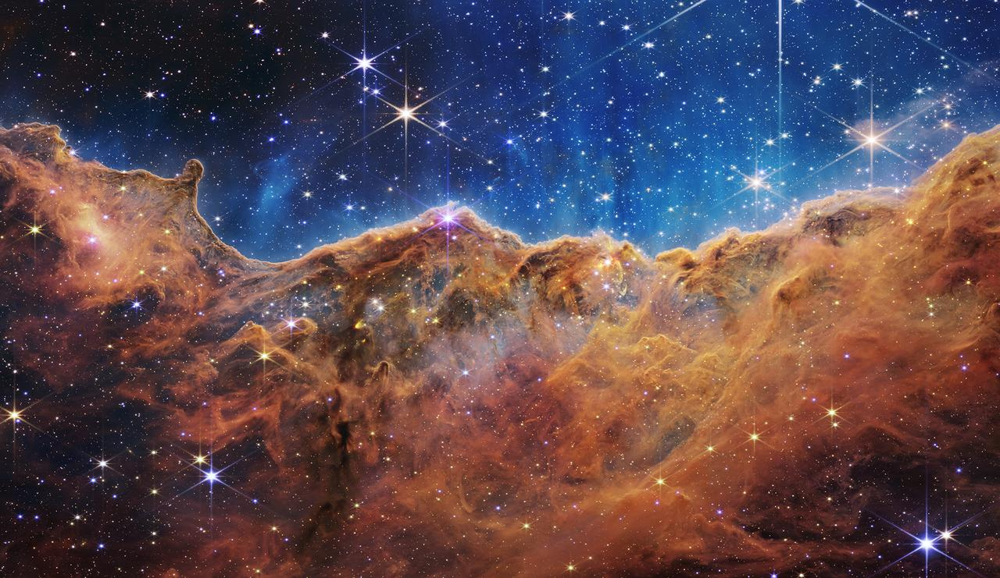
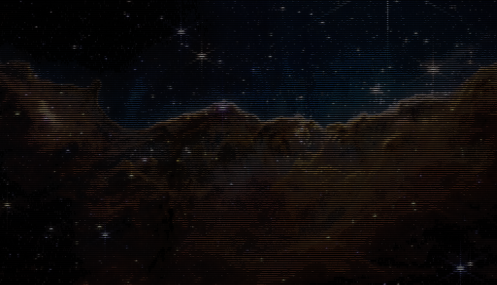
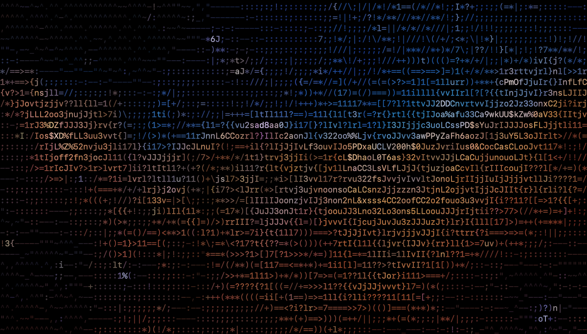
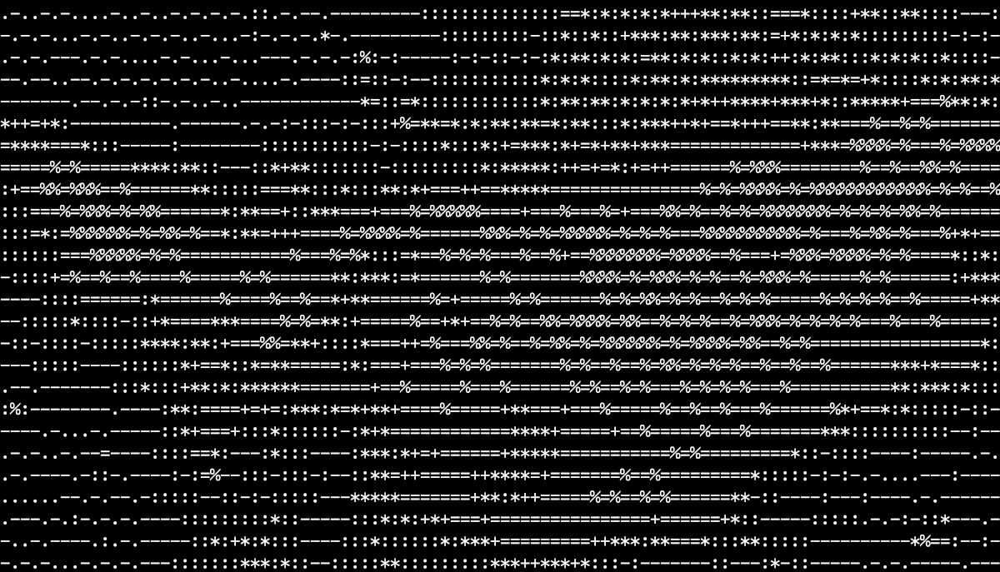
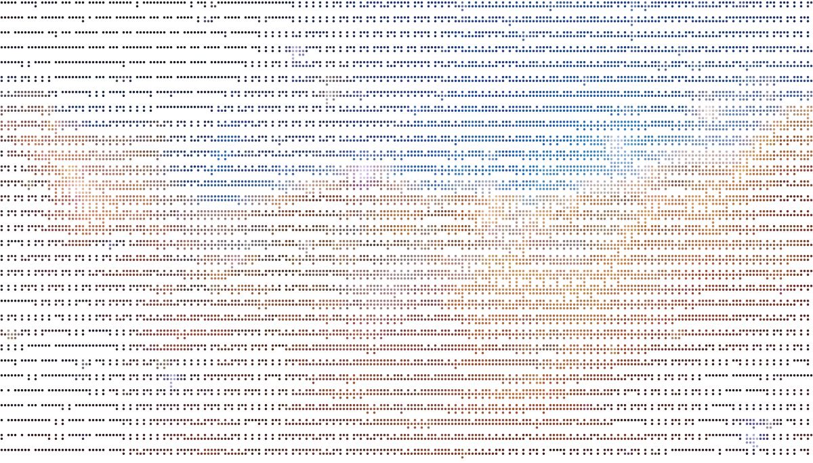

# ASCII art recipes for Swift and macOS

Start with a bundled image, then change its characters, color, or background. These
recipes use Aski's macOS CLI; the same conversion engine is available as a Swift library.

## From image to characters

| Source image | Existing Aski render |
| --- | --- |
|  |  |

The render is the README artwork: **512 columns × 133 rows of characters**. Open the
image to see the glyphs at full size. The recipes below use 100–120 columns, and each
shows the PNG its command writes.

Image credit: NASA/ESA/CSA/STScI. [Source catalog](https://images.nasa.gov/details/carina_nebula)
and [corpus provenance](../Research/Corpus/nasa-occupancy-v1/PROVENANCE.md) record the
input and its terms. This scientific false-color image is a visual example, not
evidence that one matcher is best for other images.

## Set up once

Use a Mac running macOS 15+ with full Xcode selected and a Swift 6.3+ toolchain.
These commands start from the current `main` source checkout:

```bash
git clone --branch main https://github.com/BigCactusLabs/Aski.git
cd Aski
xcrun swift --version
mkdir -p /tmp/aski-recipes
```

The first render resolves dependencies and builds the executable. Run all recipes
from the repository root. They use the bundled Carina image, so no extra download
or personal photograph is needed. For the default settings, see
[README: Try it](../../README.md#try-it).

**Version note:** `--algorithm`, `--coverage`, and `--palette` are available from
`v0.8.0`. Every recipe below uses at least one of them; the `v0.7.0` CLI does not
accept them.

All three recipes use `--algorithm dotMatrix`, which picks each glyph by brightness,
and `--coverage 1`, which applies full-strength Floyd–Steinberg dithering. The default
`logPolar` matcher picks by shape instead. On this image it draws about 40% of the color
grid's cells as `|`, and it leaves `minimal` blank. The
[algorithm guide](../../Sources/Aski/Aski.docc/Algorithms.md) records the measured
pairings and limitations.

## 1. Color ASCII

The default printable-ASCII set with source-colored glyphs on black. Saves the text
grid and a PNG exactly 1200 pixels wide:

```bash
xcrun swift run -c release aski render \
  docs/Research/Corpus/nasa-occupancy-v1/assets/carina-cosmic-cliffs.jpg \
  --columns 120 \
  --algorithm dotMatrix \
  --coverage 1 \
  --output /tmp/aski-recipes/carina-color.txt \
  --render-png /tmp/aski-recipes/carina-color.png \
  --width 1200

open /tmp/aski-recipes/carina-color.png
```



The PNG has an opaque black background and keeps the source aspect ratio. The `.txt`
file holds the characters and line breaks, without color. `--columns` sets the grid's
detail; `--width` sets the PNG's pixel width.

## 2. Monochrome, dithered

The small `minimal` set in white on the default black background:

```bash
xcrun swift run -c release aski render \
  docs/Research/Corpus/nasa-occupancy-v1/assets/carina-cosmic-cliffs.jpg \
  --columns 100 \
  --charset minimal \
  --algorithm dotMatrix \
  --coverage 1 \
  --palette monochrome \
  --output /tmp/aski-recipes/carina-monochrome.txt \
  --render-png /tmp/aski-recipes/carina-monochrome.png \
  --width 1200

open /tmp/aski-recipes/carina-monochrome.png
```



Keep `--algorithm dotMatrix` here: under the default `logPolar` matcher, `minimal`
renders every cell as a space. Set `--coverage 0` to turn dithering off.

## 3. Braille dots on a transparent ground

Unicode braille cells in source color, with an alpha-zero background:

```bash
xcrun swift run -c release aski render \
  docs/Research/Corpus/nasa-occupancy-v1/assets/carina-cosmic-cliffs.jpg \
  --columns 120 \
  --charset braille \
  --algorithm dotMatrix \
  --coverage 1 \
  --background clear \
  --output /tmp/aski-recipes/carina-braille.txt \
  --render-png /tmp/aski-recipes/carina-braille.png \
  --width 1200

open /tmp/aski-recipes/carina-braille.png
```



Only the space between dots is transparent, so the page or app behind the PNG shows
through. Your viewer may draw that area as a checkerboard, white, or its own canvas
color. To cut a subject out of the image instead, use a raster mask.

## Use your own image or integrate in Swift

Replace the bundled input path with your image's path, quoting paths that contain
spaces. Keep input and output paths distinct. The
[command-line guide](../../Sources/Aski/Aski.docc/CommandLine.md) covers masks,
manifests, reusable builds, option dependencies, and troubleshooting.

For a Swift app, [Getting Started](../../Sources/Aski/Aski.docc/GettingStarted.md)
shows how to load a `CGImage`, convert it once, and choose text or image output.
[Masking](../../Sources/Aski/Aski.docc/Masking.md) explains photo-to-type dissolves;
[Vesper](../../Sources/Aski/Aski.docc/Vesper.md) describes the fixed duotone library preset.

## Reproduction notes

The three recipe images are the unedited PNGs these commands wrote on macOS 27.0.1
with Swift 6.4 (Xcode toolchain). Raster output can vary with OS, fonts, and toolchain;
the [contributor guide](../../CONTRIBUTING.md#toolchain-and-snapshot-baseline) records
the snapshot baseline.
